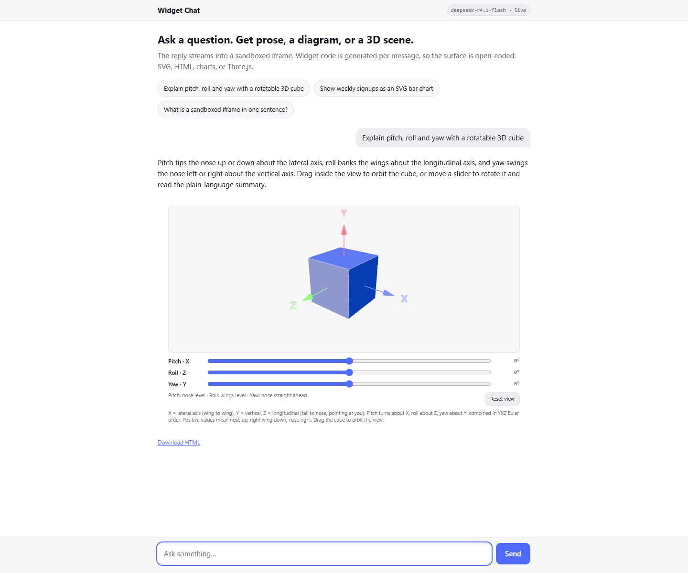
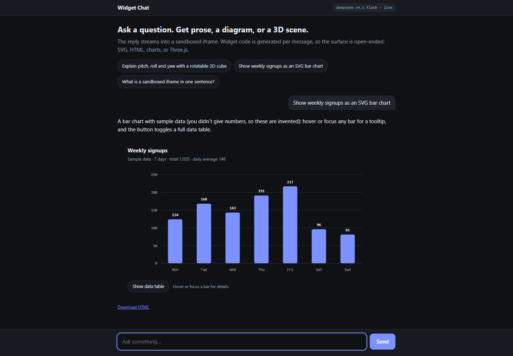

# widget-chat

A small ASP.NET Core app where the model does not fill in a component — it **writes the widget**.
A reply carries prose plus CSS, markup and JavaScript, and the browser applies each part as it
completes, in an isolated iframe.

This repo exists to support an article on building **agent-to-UI** (generative UI) with **Microsoft
Agent Framework** and **.NET**. The code is deliberately small and dependency-light so the article
can show all of it.



```
Browser ──POST /api/chat──▶ ChatEndpoints ──▶ AIAgent (Agent Framework) ──▶ provider
   ▲                             │
   │        NDJSON lines         │  WidgetStreamParser splits the reply
   └─────────────────────────────┘  into text / height / css / html / js
        │
        └─▶ WidgetHost ──postMessage──▶ sandbox iframe ──▶ eval ──▶ window.stage
```

## Status

Working end to end against a real model, and offline without one:

- 3D scenes (Three.js via importmap), SVG diagrams and charts, plain HTML widgets
- progressive streaming: CSS lands first, markup morphs in, behaviour runs once at the end
- sandboxed execution with an opaque origin, CSP and a two-call bridge
- downloadable standalone HTML that runs with no server
- 19 tests: the parser, the session store, the retry path, and every sample fixture

## Quick start

```bash
dotnet run                       # http://localhost:5080, needs an API key (below)
Llm__Provider=stub dotnet run    # offline: no key, no network, no spend
dotnet test tests/WidgetChat.Tests
```

The key is never in the repo:

```bash
dotnet user-secrets set "Llm:ApiKey" "<key>"
```

In a container or CI use `Llm__ApiKey`. Any OpenAI-compatible endpoint works: OpenAI, Azure OpenAI,
OpenRouter, Ollama (`http://localhost:11434/v1`), llama.cpp, vLLM, OpenCode.

## The problem

Filling in a `BarChart({ data })` component works until someone asks for a diagram of a hip joint or
a rotatable axis model. Every new shape means a new component, a schema, a renderer and a deploy.

The alternative is to let the model author the UI itself. That splits into two decisions, and this
repo is one answer to each:

| Decision | This repo | The other option |
|---|---|---|
| What the model emits | ordered text channels (`css`, `html`, `js`) | a tool call with typed parameters |
| Where it runs | a sandboxed iframe with its own CSP | the host page, or a typed component |

Both are defensible. §"Rejected approaches" explains the trade-offs.

## The wire protocol

The model answers with prose, then optionally this block, once, in this order:

```
@@HEIGHT:470@@
@@CSS@@     ...widget styles...
@@HTML@@    ...widget markup...
@@JS@@      ...widget behaviour...
@@END@@
```

The order is the point:

- **CSS first.** The browser gates on `cssComplete`; a widget with unstyled markup looks broken.
  Everything the widget needs is in that channel, so nothing flashes.
- **Markup next**, applied as it streams.
- **Behaviour last**, run once, so the user watches the last piece take effect.

`jsFunctions`-style declarations run as a classic script via indirect `eval`, which puts function
declarations on `window` — that is what makes `onclick="setup()"` in generated markup work.

## Server side

`Chat/ChatEndpoints.cs` streams newline-delimited JSON, one small object per chunk:

```json
{"type":"text","delta":"Pitch tips the nose"}
{"type":"height","value":470}
{"type":"css","delta":".stage {"}
{"type":"html","delta":"<div class=\"stage\""}
{"type":"js","delta":"async function setup()"}
{"type":"truncated"}
{"type":"done"}
```

NDJSON rather than SSE because the client needs no event-name plumbing. Two details are load-bearing:

- `IHttpResponseBodyFeature.DisableBuffering()` plus a flush per line. Without it Kestrel or a proxy
  holds the response until the run finishes, and the whole point is lost.
- `WidgetStreamParser` splits the text stream into channels. It holds back a partial marker at each
  chunk boundary and drops the newline that follows a marker, because real token streams cut markers
  anywhere. `SplittingAnywhereYieldsTheSameResult` feeds the sample in at every possible index.

`Agents/WidgetAgent.cs` is a `ChatClientAgent` with the channel contract as instructions and **no
tools**. `Agents/ConversationSessions.cs` hands out one `AgentSession` per browser conversation under
an exclusive lease, returning `409` rather than interleaving two runs.

## Client side

`wwwroot/widget-host.js` is the whole sandbox. Two constraints shape it:

**`srcdoc` re-navigates the frame**, so per-chunk updates cannot go through it. The frame loads one
bootstrap document and the host pushes `css`, `html` and `js` operations over `postMessage`.

**`sandbox="allow-scripts"` without `allow-same-origin`** gives the document an opaque origin: no
cookies, no storage, no same-origin fetch, no parent DOM. The host cannot even read
`contentWindow.document`. That is the security model, and it is one attribute.

Updates go through a **morph**, not `innerHTML =`. Positional child matching keeps node identity, so
the canvas, focus and scroll position survive each chunk.

**The host injects a runtime.** `window.stage` owns the renderer, camera, lights, pixel ratio,
container resizing, the single animation loop, a `reducedMotion` flag, `pause`/`resume`/`dispose` and
teardown. Generated code says:

```js
const stage = window.stage.mount({ THREE, OrbitControls, canvas: document.getElementById('scene') });
const cube = stage.add(new THREE.Mesh(geometry, material));
stage.onFrame(now => { /* tween inside the one loop */ });
stage.onDispose(() => { geometry.dispose(); material.dispose(); });
```

It travels as text (`fn.toString()`) because the frame CSP is `default-src 'none'` and an opaque
origin means `'self'` matches nothing — the frame can load no script of ours. Every injected function
must therefore be self-contained.

`WidgetHost` also pauses animation off screen through an `IntersectionObserver`, because browsers keep
only ~8–16 live WebGL contexts and silently drop the oldest. Pausing does not free a context, so
`app.js` also releases the oldest off-screen widgets once twelve are alive. Their Download HTML still
works, and the slot says why the frame is gone.



## Isolation

```
default-src 'none';
script-src 'unsafe-inline' 'unsafe-eval' https://esm.sh;
img-src data: blob:;  font-src data:;  connect-src https://esm.sh;
```

`'unsafe-eval'` is load-bearing — it is how the `js` channel runs. Everything reachable from the frame
is one allowlisted CDN and nothing else. The host page has no CSP of its own: an `srcdoc` frame
inherits its parent's policy, so a `script-src` here would also apply inside the frame and block the
runtime or esm.sh. The host page never inserts generated HTML, so it does not need one.

The bridge is not a security boundary either: the widget frame can post the same `bridge` messages
the injected runtime posts. The host validates every argument, and the real bound on widget-started
prompts is five per page load. The click check inside the frame only raises the bar.

Three.js is not bundled: an importmap in the frame head maps `three` and `three/examples/jsm/*` to
esm.sh. That is the entire dependency story for 3D.

## Rejected approaches

**Tool calling as the transport.** The intuitive choice: `generateSandboxedUi(css, html, js)` with a
schema. Rejected because the arguments arrive as partial JSON that has to be reassembled, and it buys
no ordering guarantee that a text stream doesn't already give. The cost of the text format is the
absence of schema validation, which the prompt and the parser absorb.

**A reference-widget tool.** It handed the model a complete working widget on request, which looked
like good grounding. With a reasoning model it was a net loss: 3.7× the input tokens, a second full
reasoning round, and roughly one empty reply in three. Removed. Grounding belongs in the prompt.

**A hardcoded temperature.** `0.4` was fine for one model and a hard `400 invalid temperature: only 1
is allowed` for two others. Omitted by default now, opt-in via `Llm:Temperature`.

**A `Body.innerHTML = html` update.** Simplest possible streaming, and it destroys every node each
chunk. Replaced with a positional morph.

**Typed components for everything.** Still the right answer for a fixed set of widgets — a table does
not need an iframe or a model-authored stylesheet. The interesting split is: typed component where
the shape is known, generated UI where variety is the point.

## Outline for the article

1. **The claim.** A component registry does not scale to "draw me a diagram of X". Generated UI does,
   if you solve ordering, isolation and reliability.
2. **Two decisions, four combinations.** Model emits ordered channels or typed parameters; code runs
   in your document or in a sandbox. Why this repo picks text channels + iframe.
3. **The contract.** Show the six-part reply and explain why the order is load-bearing.
4. **.NET specifics.** `ChatClientAgent`, `RunStreamingAsync` text deltas, `AgentSession` per
   conversation, and the one line that makes streaming actually stream (`DisableBuffering`).
5. **The parser.** Token streams cut markers anywhere. Show `SplittingAnywhereYieldsTheSameResult`.
6. **The sandbox.** One attribute (`sandbox="allow-scripts"`), one CSP, one importmap. Why
   `'unsafe-eval'` is unavoidable and what it costs.
7. **Deleting boilerplate.** `window.stage` and what it fixed: flat-looking cubes, zero-height
   canvases, leaked renderers, second animation loops.
8. **What went wrong, with numbers.** The reference tool (3.7× tokens, 1-in-3 empties), the 8,000
   token cap (15,381 observed), the temperature 400. This is the section readers will trust.
9. **What it costs.** 35–65 s and ~12k tokens per widget. When a typed component is simply better.

## Experiments worth running before publishing

- One question that needs no visual, to show the widget-capable prompt still answers in prose — and
  what that costs versus a cheap classifier deciding first.
- Accessibility pass on a generated widget: keyboard path, focus, contrast, text alternative for a
  canvas. The contract asks for these; how often does the model deliver?
- Failure injection: point `BaseUrl` at an unreachable host, then at a 401, and screenshot what the
  user sees. Error handling is a good section and easy to forget.

## Layout

| Path | Role |
|---|---|
| `Program.cs` | DI wiring, static files, endpoint mapping |
| `Chat/WidgetPrompts.cs` | the channel contract — half the design |
| `Chat/WidgetStreamParser.cs` | incremental split into channels; the only tricky code |
| `Chat/ChatEndpoints.cs` | NDJSON streaming, retry, truncation and provider error mapping |
| `Agents/WidgetAgent.cs` | `ChatClientAgent`, instructions, no tools |
| `Agents/ConversationSessions.cs` | one `AgentSession` per conversation, leased |
| `Llm/ChatClientFactory.cs` | provider selection, user agent, session header |
| `Llm/OpenCodeSessionPolicy.cs` | adds `x-opencode-session` per request |
| `Llm/StubChatClient.cs` | offline provider and deterministic fixture |
| `Samples/*.widget.txt` | worked examples in the format; the stub's replies |
| `wwwroot/widget-host.js` | sandbox: bootstrap, injected runtime, morph, bridge, export |
| `wwwroot/app.js` | chat UI, NDJSON reader, widget lifecycle |
| `AGENTS.md` | operational notes, invariants, known failure modes |

## Credit

The approach follows [OpenIntelligentUI](https://github.com/CopilotKit/OpenIntelligentUI): ordered
streaming channels, a sandboxed frame, an injected runtime helper, and a portable export. The
differences here are deliberate and documented above — text channels instead of tool-call
parameters, and a hand-written frame protocol instead of `websandbox`.

## License

MIT. See [LICENSE](LICENSE).
